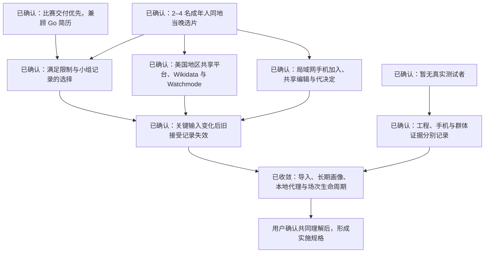

# CommonReel 产品需求访谈

更新日期：2026-10-13。使用 grill-with-docs、grilling 与 domain-modeling。

本文持续记录用户已经作出的决定、当前工程事实、待验证的需求假设和下一轮问题。未确认的建议不构成实施规格；本轮不修改功能代码。

## 已确认的根决策

| 编号 | 决定 | 依据 |
|---|---|---|
| Q1 | 比赛交付优先，兼顾有证据的 Go 简历成果 | 用户本轮明确选择 |
| Q2 | 首批目标用户是有共同观影习惯的 2–4 名成年室友或朋友，在同一地点决定今晚看哪部电影 | 用户本轮明确选择 |
| Q3 | 目前没有真实测试者 | 用户本轮明确说明 |
| Q4 | 初始主要价值假设为找到满足当晚限制、全员明确接受的一部电影；选片速度为次要观察指标 | 初始选择；接受语义随后由 Q11 改为可代决定的小组记录 |
| Q5 | 首版固定美国地区，由用户勾选已订阅平台；显示来源与应用查询时间，不能承诺个人账户免费权益 | 用户本轮选择推荐答案；来源更新时间未提供时不虚构 |
| Q6 | 每个人使用自己的手机加入 | 用户本轮明确选择，覆盖主持人操作共用屏幕的原建议 |
| Q7 | 手机与服务电脑在同一 Wi-Fi 内加入，首版不要求互联网 HTTPS 部署 | 用户本轮选择推荐答案 |
| Q8 | 所有人都可以代别人修改和确认 | 用户本轮明确选择，覆盖“只修改/确认本人”的原建议；代操作语义已由 Q11 澄清 |
| Q9 | 必须处理类型否决、最长片长、勾选平台、明确标记已看/是否重看；平台供应不承诺账户免费权益 | 用户本轮选择推荐答案 |
| Q10 | 接入外部账号或完整观看历史 | 用户本轮明确选择，覆盖必填 2–3 部喜欢影片的原建议；具体来源与用途已由 Q14–Q15 收敛 |
| Q11 | 允许替别人作决定；结果称为“小组记录的选择” | 用户本轮明确选择，修改 Q4 的结果语义；不能宣称全员本人接受 |
| Q12 | 片长或所选地区订阅供应未知、不满足时排除，宁可无结果 | 用户本轮选择推荐答案 |
| Q13 | 无结果时说明条件冲突，等待小组明确调整后继续 | 用户本轮选择推荐答案 |
| Q14 | 首版支持 Netflix 官方观看历史 CSV 导入；实际账号同步后续再做 | 用户本轮选择推荐答案，收敛 Q10 |
| Q15 | 历史用于识别已看；明确评分/喜欢才用于偏好，不能把看过自动当喜欢 | 用户本轮选择推荐答案 |
| Q16 | 收齐每个成员条目的接受记录后保存，允许代填 | 用户本轮选择推荐答案，与 Q11 一起定义保存条件 |
| Q17 | 片长上限和今晚设备可用的平台为房间共享条件；类型否决和已看按成员合并 | 用户本轮选择推荐答案：任一类型否决排除；禁止重看时任一已看排除；至少一个勾选平台有美国订阅供应 |
| Q18 | 关键输入变更后旧接受记录失效，重新筛选和表态 | 用户明确回复“18、19、20 都按推荐” |
| Q19 | 首版加入真实代理，通过 Go MCP 修改条件、继续协商、解释候选；表单可独立完成流程 | 用户明确回复“18、19、20 都按推荐” |
| Q20 | 接受免费供应 API key，数据侧预算零；选择 Wikidata 元数据＋Watchmode 应用内非图像供应查询 | 用户明确回复“18、19、20 都按推荐”；供应原始数据不送第三方模型，不随源码分发受限缓存 |
| Q21 | 历史导入可跳过；可靠匹配的电影才计入已看，歧义、剧集和未匹配标题列出待确认 | 用户选择推荐答案；不把未匹配或无历史说成从未看过 |
| Q22 | 长期保存个人历史和偏好，供以后场次复用 | 用户明确选择，覆盖原先仅当晚使用后清理的建议；数据范围与权限由 Q26–Q28 收敛 |
| Q23 | 只接受零费用的本地模型，不使用付费模型 API | 用户明确选择，覆盖新增模型费用上限 20 元的建议 |
| Q24 | 代理处理明确的条件/偏好修改、推荐与解释；表态、保存、删除走页面按钮；归属不清追问 | 用户选择推荐答案 |
| Q25 | 工程验收逐项记录，手机实测与真实小组效果分别标注 | 用户选择推荐答案；没有对应证据的项不宣称通过 |
| Q26 | 恢复码维护长期画像；房间内共享修改不自动写回长期画像，无需注册账号 | 用户选择推荐答案 |
| Q27 | 长期保存规范化历史、必要待确认标题和稳定偏好，原始 CSV 不保存；当晚设置和代填接受留在场次 | 用户选择推荐答案 |
| Q28 | 恢复码持有者可删除画像并撤回活动场次关联资料，旧接受记录失效；已保存选择可保留匿名摘要 | 用户选择推荐答案 |
| Q29 | 首版在约 200–300 部标识与资料可核对的电影中完成闭环，明确目录覆盖范围 | 用户选择推荐答案；完整历史导入不等于覆盖全部流媒体影片 |
| Q30 | 场次结束或 24 小时过期后清理成员/临时资料/历史副本，仅保留匿名选择摘要；长期画像到主动删除前保留 | 用户选择推荐答案 |
| Q31 | 确认完整范围与预期一致，结束本次需求访谈 | 用户明确选择“确认，完整范围与我的理解一致” |

目标用户的选择确定了设计对象，尚未证明他们的痛点频率、使用意愿或产品效果。没有真实小组试用时，真实数据评价、脚本场景测试和工程测试分别记录，不以这些结果替代用户验证。

当前主要结果定义已经由 Q11 修订为：找到满足已记录硬性限制的一部电影，收齐各成员条目的接受记录，并保存“小组记录的选择”。接受记录允许别人代填或替别人决定，不能称为全员本人同意。

## 本轮复核的比赛约束

- 截止时间为北京时间 2026-10-24 03:00，即 2026-10-23 12:00 PDT。[官方首页](https://amazonappdev2026.devpost.com/)、[Rules §1](https://amazonappdev2026.devpost.com/rules)。
- Alexa+ 可以提交运行中的 Agent Skill 或自托管 MCP；MCP 采用 2025-11-25 及 Streamable HTTP 是规则明确的路径。也可以使用自选 AI 或 agentic tool 构建网页模拟，提供源码与实际运行视频；该替代路径无指定 SDK 或 MCP 形状要求。[Rules §4](https://amazonappdev2026.devpost.com/rules)、[Resources](https://amazonappdev2026.devpost.com/resources)。
- 必须提交项目说明、可供评审访问的源码仓库及运行说明、少于三分钟的公开 YouTube/Vimeo 演示视频、所用工具/API/SDK 的产品反馈及赛道选择。材料须英文或提供英文翻译。仓库可以公开并附许可证，也可以私有并共享给指定评审；没有强制公众线上部署要求。[官方首页](https://amazonappdev2026.devpost.com/)、[Rules §4](https://amazonappdev2026.devpost.com/rules)。
- 初审检查基本可行性与赛道适配。后续技术实现、设计、潜在影响、创意质量四项等权；可信且具体的客户需求影响评分。单轮问答、基础 API 包装与跨服务流程、跨会话上下文等是不同创意层次的示例，后者并非全部必须实现。[Rules §6](https://amazonappdev2026.devpost.com/rules)。
- 真实硬件、AWS、特定用户访谈数量、特定推荐指标和商业收入均不是该 Alexa+ 路径的统一硬要求。参与资格与数据授权仍须按实际情况满足规则；网上可以获取数据不等于已获得所有使用权。[Rules §3–4](https://amazonappdev2026.devpost.com/rules)。
- 现有纯脚本对话是否足以满足网页模拟路线的 AI/agentic-tool 表述，不能自行确认；现有真实 MCP 接口可作为技术路线的工程基础。正式资格和提交状态仍由实际注册、提交及主办方判断。

## 当前实现与用户任务的差距

| 当前工程事实 | 对产品定义的影响 | 仓库依据 |
|---|---|---|
| 研究画像可选，演示姓名与研究历史人为绑定 | 不能把匿名评分者的历史写成当前观影者的偏好；真实来访者的偏好获取需要单独定义 | README.md；docs/DATA.md；internal/app/web/app.js |
| 类型喜欢/否决可以输入，没有片长、地区供应或账户权益 | 目前只支持类型标签范围的约束；不能承诺今晚可看、不额外收费或完整内容适宜性 | internal/catalog/catalog.go；docs/DATA.md |
| 对话只有四个固定意图；no horror 修改首个成员 | 后续需要明确一句话属于谁，并核对变更对象；当前不能主张开放式多轮协商 | internal/app/web/app.js |
| 保存由一人一次点击完成 | 新范围要求各成员条目的可代填接受记录后保存；该流程尚未实现 | internal/app/app.go；internal/room/room.go |
| 随机房间链接允许编辑所有成员，服务限本机访问 | 新范围已选局域网手机共享参与；现有标签页同步不能证明这项能力 | README.md；internal/app/app.go |
| 现有 MovieLens 留出指标来自单人排序任务 | 能支持固定协议下的推荐评价，不能证明真实小组更快选片或更满意 | README.md；docs/evidence/evaluation.json |

代码还有命名边界需要保持清楚：目前名为 popularity 的排序按平滑后的目录平均评分运行，不能将它描述为评分次数或播放热度排序。本轮先记录，后续规格确定时处理命名与报告的一致性。

## 当前设计树

## 第二轮已确认

Q4–Q6 的答案见上表。手机加入意味着必须验证多设备访问与参与者独立修改/表态；本机多个标签页同步无法替代这一要求。

## 第三轮已确认

Q7–Q10 的答案见上表。允许代操作是用户明确选择，不能继续按“只有本人才有权修改/确认”写产品规格。它与全员接受的关系需要澄清：代录现场明确意见，或允许替他人作决定，是两种不同的产品含义。

## 第四轮已确认

Q11–Q13 的答案见上表。“共同选择”保留给真实全员明确接受的概念；首版产品结果使用“小组记录的选择”。已经收敛的约束和未知值处理规则需要落实在确定性筛选中。

## 第五轮已确认

Q14–Q16 的答案见上表。Netflix CSV 导入与连接 Netflix 账户不是同一能力，首版不得放置无法完成正式授权的账号同步承诺。

Netflix 官方已确认每个 profile 可从 Viewing activity 下载 CSV；个人数据副本可能最多 30 天，评分结构也不保证与 MovieLens 相同。Trakt 官方提供 OAuth 历史/评分 API，但注册应用涉及 verified GitHub 和 VIP 前提，尚未申请或真实授权验证。[Netflix 观看历史](https://help.netflix.com/en/node/101917)、[Netflix 个人数据副本](https://help.netflix.com/en/node/100624)、[Trakt OAuth](https://developer.trakt.tv/docs/authentication-oauth)、[Trakt 官方 VIP 应用注册改动](https://github.com/trakt/trakt-web/pull/3057)。

## 第六轮已确认

Q17–Q20 已接受。用户明确回复“18、19、20 都按推荐”，其决定见上表。实现和真实请求验证尚未发生，接受方案不能写成已完成的能力。

## 第七轮已确认

Q21–Q25 的答案见上表。两项明确覆盖原建议：用户选择长期复用个人资料，模型只走零费用本地路径。不得继续使用原先“场次结束后删除一切个人资料”或“允许 20 元模型支出”的范围。

## 第八轮已确认

Q26–Q28 的答案见上表。长期画像由恢复码持有者维护；多人当晚代操作作用于场次资料，不自动改写长期画像。删除需覆盖长期存储、缓存、活动场次副本及可能残留个人历史的保存响应，不能只移除一个列表入口。

## 第九轮已确认

Q29–Q30 的答案见上表。所有当前产品取舍均已收敛，随后用户在 Q31 确认完整文档与其理解一致，需求访谈完成。

本轮事实核查：项目没有模型端点/模型名/密钥配置入口，也没有 .env 示例。PATH 中有 Ollama CLI 0.33.3，但本机 11434 模型列表请求被拒绝；未启动服务或下载模型。这只能说明现成可运行的本地路径未建立，不能推断磁盘没有模型。

只读硬件检查得到总内存 15.58 GiB、当时可用约 5.6 GiB；RTX 5060 Ti 显存总计 16,311 MiB、空闲 14,449 MiB。默认模型目录有 SparkLLM/Spark-X2.5-4B:latest 的 manifest 和两份 blob 文件记录，未校验或加载。Ollama 官方 /api/chat 支持 tools/function schema 与代理循环；基于硬件和官方能力声明，qwen3.5:4b 是待实测候选，不是已经可运行的代理。[工具调用](https://docs.ollama.com/capabilities/tool-calling)、[Chat API](https://docs.ollama.com/api/chat)、[Qwen3.5 官方库](https://ollama.com/library/qwen3.5)。

当前局域网路径也需要实施工作：监听地址和 Host 检查仅允许 loopback；前端使用的 crypto.randomUUID 在手机的普通局域网 HTTP 环境还有安全上下文兼容问题。没有把“同一 Wi-Fi”写成现有能力，也没有开端口或部署服务。

历史来源路径已由 Q14、Q21、Q26–Q28 收敛为可跳过的 CSV 导入、可靠电影匹配、规范化长期画像及恢复码维护。原始 CSV 不保存，不取得 Netflix 账号密码；查询电影只使用所需片名/年份，不发送完整个人历史。

## 外部数据的实际依赖

TMDB 官方技术文档支持电影检索、片长和美国平台供应，但不能将技术可用写成当前用途已获许可。官方 FAQ 的非商业免费说明与官方 API Terms 搜索可见版本对 AI/ML 用途的限制存在需要核实的差异；当前条款正文未能实时直读确认。具体用途授权未解决前，它只是候选来源，不是已批准的实现依赖。[FAQ](https://developer.themoviedb.org/docs/faq)、[API Terms](https://www.themoviedb.org/api-terms-of-use?language=en-CA)。

watch/providers 的公开响应 schema 没有供应来源更新时间；只能记录应用本次查询时间，不能将其称为 JustWatch 的更新时间。平台提供、订阅类别、个人账户权益和直接播放链接需分别表述。[官方接口说明](https://developer.themoviedb.org/reference/movie-watch-providers)。

Wikidata 结构化电影数据采用 CC0，可用 QID、片长、类型与 IMDb ID 等，但缺字段和时长单位/版本差异必须检查；其元数据不能独立证明美国平台供应。[许可](https://www.wikidata.org/wiki/Wikidata:Licensing)、[数据访问](https://www.wikidata.org/wiki/Wikidata:Data_access)。

Watchmode 官方文档提供美国供应及 sub/rent/buy/free/tve 分类、电影时长和稳定 ID。当前 Developer 免费计划为每月 2,500 credits、最多三个国家、无需信用卡，须 key 与署名；credits 不等于所有请求一律一 credit。免费非图像缓存最多 30 天，随后刷新或删除；图片 URL 不提供图片许可证。当前条款授权自有应用使用非图像数据，同时限制数据分享/再分发，因此首版候选架构将供应原始数据留在应用内确定性处理和展示，不直接传给第三方模型，也不捆绑进公开源码。[文档](https://api.watchmode.com/docs)、[计划](https://api.watchmode.com/#plans)、[2026-09-01 条款](https://api.watchmode.com/tc)。实际 key、真实供应请求和用途边界尚未进行账户级验证。

ml-1m 不包含 TMDB ID；其他 GroupLens 数据集的 links.csv 可以作为候选映射，但跨数据集的 ID、片名/年份匹配和覆盖率需要实测。原始研究数据的使用与再分发依对应数据集条款。[ml-1m 官方说明](https://files.grouplens.org/datasets/movielens/ml-1m-README.txt)、[latest-small 官方说明](https://files.grouplens.org/datasets/movielens/ml-latest-small-README.html)。

完整场景与验收已确认并保存为 PRODUCT_REQUIREMENTS.md，PRODUCT_SCOPE_DRAFT.md 保留指向正式文档的入口。免费数据 key、本地模型加载和真实手机设备等运行条件会在实施准备中按实际可获得性核实；不读取或复用其他应用的认证。模型规格、界面排版、缓存实现等常规实施选择按已确认的零费用与证据边界执行，不继续逐项询问。

## 文档记录规则

已经确定的领域词汇即时维护在根目录 GLOSSARY.md。只有遇到难以逆转、需要解释背景且确实权衡过替代方案的决定，才创建 ADR。共享编辑、可代决定与结果语义的边界已记录在 docs/adr/0001-group-records-allow-proxy-decisions.md，避免未来将代填记录误写为本人同意。

长期画像的恢复码维护和当晚共享修改边界已记录在 docs/adr/0002-reusable-profile-and-session-copy.md。模型推理全部采用本地路径，不以把完整长期历史塞进模型上下文实现复用。

访谈结束条件是所有设计分支均已收敛，用户确认已经形成共同理解。用户已在 Q31 确认，需求访谈完成；本轮没有按新范围修改功能代码、部署服务、申请数据 key 或加载模型。
