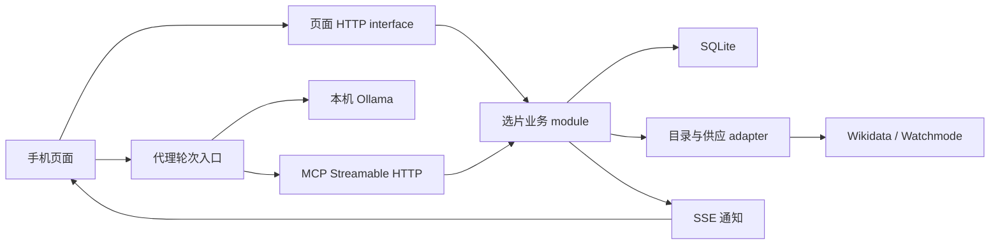

> Current execution and evidence: [IMPLEMENTATION_STATUS.md](IMPLEMENTATION_STATUS.md), [ACCEPTANCE.md](ACCEPTANCE.md). Original requirement/creation-time status below is retained as history.

# CommonReel Implementation Spec

版本：0.1 · 日期：2026-10-13 · 状态：READY_FOR_IMPLEMENTATION，前置运行验证待执行。跟踪方式：本地文档；未配置外部 issue tracker，本次任务不发布远程 issue。

依据：[已确认需求](PRODUCT_REQUIREMENTS.md)、[Q1–Q31 访谈决定](PRODUCT_DISCOVERY.md)、[领域词汇](../GLOSSARY.md)、[共享代操作决策](adr/0001-group-records-allow-proxy-decisions.md)、[长期画像决策](adr/0002-reusable-profile-and-session-copy.md)。本 spec 是本地实施依据，不表示功能或验收已完成。既有工程原型继续按其原有证据范围描述。

## Problem Statement

2–4 名成年室友或朋友在同一地点准备看电影，需要把当晚片长、可用平台、各人的类型否决与已看资料放到同一个选片过程中。现有原型只支持本机标签页、研究画像、类型筛选与单人点击保存，无法完成真实手机加入、实际观看历史、可核对时长/供应或持续的对话协商。

目标人群和需求是设计假设，目前没有真实小组试用。工程要解决的是条件执行、资料来源、多人一致性和选择记录的可验证行为。支持代填和代决定意味着结果只能称为“小组记录的选择”，不能证明全员本人同意，也不能承诺群体满意或节省时间。

## Solution

一台电脑运行 Go 应用、SQLite 和本地 Ollama 模型。成员通过同一 Wi-Fi 内的手机邀请链接或二维码加入，可共同维护当晚资料、输入明确偏好、导入 Netflix CSV，或用恢复码载入已有长期画像。

在约 200–300 部具有可核对标识的电影中执行硬筛选，向小组提供少量候选、来源事实和推荐估计。选择一部当前候选后，记录每个成员条目的接受/反对，允许代填；全部条目接受且条件仍有效时，通过页面保存选择。条件或成员变化使旧接受记录失效。

本地代理通过真实 MCP 修改明确条件、重新推荐和解释；归属不清时追问。页面负责表态、保存和删除，模型失败仍可用表单完成流程。画像长期保存，当晚副本结束或 24 小时后清理。

## User Stories

1. 作为创建者，我希望分享链接或二维码，以便同一 Wi-Fi 内的朋友加入。
2. 作为参与者，我希望使用昵称而无需注册账号，以便快速进入选片。
3. 作为参与者，我希望看见当前成员和最新条件，以便知道自己的操作影响哪个小组。
4. 作为参与者，我希望可以代别人维护当晚资料，以便熟人小组共同操作。
5. 作为参与者，我希望所有人的修改能同步，以便各台手机讨论同一状态。
6. 作为重新联网的参与者，我希望马上恢复最新状态，以便不依赖下一次修改才看到变化。
7. 作为参与者，我希望设置共同设备可用的平台和片长上限，以便候选符合当晚情况。
8. 作为参与者，我希望类型否决得到严格执行，以便不会因排名分数高而被忽略。
9. 作为参与者，我希望选择是否允许重看，以便已看记录有明确作用。
10. 作为参与者，我希望可以跳过历史导入，以便没有 Netflix 文件也能加入。
11. 作为导入者，我希望导入完整观看历史 CSV，以便减少已看资料的重复录入。
12. 作为导入者，我希望看见重复、剧集、歧义和未匹配的报告，以便知道哪些记录生效。
13. 作为导入者，我希望手动确认同名电影和库外标题，以便匹配不会猜错。
14. 作为参与者，我希望看过与喜欢分别记录，以便系统不会把所有播放记录当成偏好。
15. 作为画像恢复码持有者，我希望跨场次加载历史和稳定偏好，以便重复使用。
16. 作为画像恢复码持有者，我希望房间代修改不会自动改写长期画像，以便临时决定不会污染资料。
17. 作为画像恢复码持有者，我希望明确保存长期修改，以便控制复用内容。
18. 作为画像恢复码持有者，我希望删除画像并撤回活动场次副本，以便个人资料不再通过应用读取。
19. 作为参与者，我希望只收到时长和订阅供应已确认的候选，以便未知数据不会当作满足条件。
20. 作为参与者，我希望看见平台供应类别和查询时间，以便区分订阅、租赁、购买与个人权益。
21. 作为参与者，我希望目录覆盖范围清楚，以便不误以为系统检索全部流媒体影片。
22. 作为参与者，我希望获得少量候选和简短权衡解释，以便继续讨论。
23. 作为参与者，我希望没有结果时看到过滤原因，以便明确调整条件。
24. 作为参与者，我希望条件不会被助手自动放宽，以便保留小组的限制。
25. 作为参与者，我希望对话明确修改对象，以便“我不想看恐怖片”不会随意写给首个成员。
26. 作为参与者，我希望对话继续使用当前场次条件，以便无需反复描述。
27. 作为参与者，我希望模型失败时表单仍可用，以便完成当晚选片。
28. 作为参与者，我希望提出一部当前候选并收齐成员条目的表态，以便保存过程有明确依据。
29. 作为参与者，我希望输入变化后旧接受记录失效，以便不会沿用过时选择。
30. 作为参与者，我希望重复点击不会保存多份相同结果，以便网络重试可靠。
31. 作为参与者，我希望知道接受记录可代填，以便不会误解它为本人认证。
32. 作为参与者，我希望结束场次后留下匿名摘要，以便保留选择而不长期暴露成员历史。
33. 作为运行者，我希望数据和模型新增费用均为零，以便原型不依赖付费服务。
34. 作为维护者，我希望工程、真实数据、手机与用户效果证据分别记录，以便简历及参赛说明准确。

## Implementation Decisions

### 1. Module 与 interface

| Module | Interface 和职责 | 当前关系 |
|---|---|---|
| 选片业务 | 处理场次命令/查询、权限、版本、接受失效、保存、画像副本与撤回 | 复用现有 room/App 事务能力，集中规则，避免 HTTP/MCP 各自实现 |
| 长期画像与导入 | 规范化历史、稳定偏好、匹配报告、恢复码维护及删除 | 新增；与研究画像 ID 分开建模 |
| 电影目录与供应 | 稳定 film_id、元数据来源、供应状态/时效、匹配与配额 | 扩展目录；外部 adapter 可替换为测试 adapter |
| 筛选与排序 | 一个 eligibility 判断供候选和保存使用；通过筛选后才估计和排序 | 复用 recommend 思路，扩展硬条件，调整真实画像输入 |
| 本地代理 | 有限模型循环、真实 MCP client、白名单、当前场次上下文与失败兜底 | 新增；模型不拥有持久化规则 |
| 页面与传输 | 手机表单、邀请、HTTP 控制命令、MCP 与 SSE | 保留 Go 嵌入静态资源；显式 LAN 模式 |

外部测试 seam 优先使用整个应用的 HTTP interface：页面控制接口与真实 MCP endpoint 都进入同一业务 module。SQLite 使用真实临时数据库；只有实际变化的外部数据、模型与时间提供可替换 adapter，不为每个内部函数建立 interface。

### 2. 身份、权限与秘密

| 调用持有权 | 可执行的操作 |
|---|---|
| 房间邀请凭据 | 读取/维护该活动场次、代修改/代表态、通过页面保存或结束该场次；不能枚举或修改长期画像 |
| 画像恢复码 | 加载、明确更新、删除该画像，显式应用到有房间权限的成员条目 |
| 代理场次上下文 | 读取该场次与目录、修改明确成员的当晚偏好及房间条件、推荐/解释；没有表态/保存/删除/画像写回权限 |

标识与秘密分开：session_id/profile_id 是标识，不自行赋予权限。邀请与恢复码采用至少 128 位不可预测随机秘密；恢复码默认 256 位。数据库保存凭据摘要，秘密不进日志、SSE、模型消息、查询参数或幂等回执。

页面生成恢复码时使用安全随机值，在创建请求中提交，自己展示并保存；服务端只保存摘要，不在幂等响应里回传恢复码。缺少安全随机能力时明确失败，不降级为 Math.random。邀请信息可放在链接 fragment，页面读取后在请求头使用，不发送到 Referer；昵称及操作者标记是自报信息，不证明真实身份。

恢复码维护无需注册账号，丢失恢复码没有邮箱找回或现实身份认证流程。房间共享能力与画像维护能力不能互相替代。

### 3. 领域记录和持久化

SQLite 单实例、WAL 与事务继续使用，不引入 Redis 或多副本。

| 记录 | 必须包含的信息 |
|---|---|
| Film | 稳定 film_id；QID/IMDb/供应商标识及映射来源；标题/年份/别名；规范化类型；时长及来源、冲突状态；catalog_version |
| Availability | film_id、region=US、provider_id、monetization、matched/unknown 状态、fetched_at、expires_at、应用内来源链接、facts_version |
| ReusableProfile | profile_id、recovery_hash、profile_revision、已匹配/手工确认的已看电影、明确评分/喜欢、稳定类型偏好、待确认标题、删除状态 |
| SelectionSession | session_id、invite_hash、status、created_at/expires_at、room_revision、decision_version、2–4 成员条目、共享政策、当前候选与接受记录 |
| SessionMember | member_id、昵称、可选来源 profile_id/profile_revision、独立当晚副本、明确偏好、否决、已看与来源标记；不保存恢复码 |
| ActiveCandidate | film_id、decision_version、所用目录/供应事实版本、验证时间与有效期限 |
| AcceptanceRecord | target_member_id、film_id、decision_version、pending/accept/reject、操作者自报 ID、操作时间 |
| ChoiceSummary | summary_id、film_id、保存时间、必要共享条件、事实版本、记录状态；无昵称、历史、评分和逐成员解释 |
| OperationReceipt | scope_id、operation_key、规范化请求摘要、结果码、资源 ID 与提交版本；不缓存完整画像/房间 JSON 或秘密 |

影片使用统一 film_id；MovieLens movie ID 仅作为研究来源映射，不把它当作 Wikidata/IMDb/Watchmode ID。研究画像与真实长期画像使用不同命名空间，不能从旧研究 profile ID 自动迁移为真人历史。

画像应用到场次时复制所需资料，并记录来源版本。之后更新长期画像不会隐式改变活动场次；显式再次应用时更新副本并使旧接受失效。场次代修改不写回长期画像，写回需要恢复码权限与明确命令。

### 4. 场次与选片状态

场次状态为 active、closed、expired。创建后固定 24 小时过期，不因聊天或投票续期；结束/过期清理所有成员和个人副本，只留匿名选择摘要及必要的非个人状态。

active 场次允许先有 0–1 人用于加入准备；有 2–4 人且片长/平台政策有效后才生成可保存的候选。第 5 人加入拒绝。昵称可重复，操作对象始终使用 member_id；对话同名或无对象时追问。

选片状态为 collecting、ready、proposed、recorded；no_candidates 是 ready 的有解释空结果，不自动放宽限制。页面选择一部候选建立 ActiveCandidate；接受记录必须全部针对同一影片与 decision_version。没有当前候选、存在 pending/reject 或资料过期时保存失败。

保存完成不自动结束场次，也不自动添加已看。之后改变输入会撤销当前有效接受与候选，旧选择只保留匿名历史记录并标明所依据版本；再次保存属于新的决定。

#### 两种版本

- room_revision：每个已提交的场次状态写入递增，包含加入、输入、候选选择、表态和保存；用于 CAS、刷新与 SSE。
- decision_version：仅在选片依据变化时递增，包含成员集合、偏好/已看、硬政策、候选影片、影响资格的目录/供应事实变化；用于绑定候选与接受。
- 单纯某成员的表态只增加 room_revision，不增加 decision_version，也不清空其他成员对同一候选的有效表态。
- 任一选片依据变化：同一事务内递增两个版本、撤销当前接受，并清空或标过时当前候选。不能先返回成功再异步失效。
- 相同有效输入的无实际变化 patch 返回 no_change；不制造新 decision_version。显式提新候选会使旧表态失效。

候选所需事实过期、未知或不再满足政策时必须失效。刷新后事实完全相同可更新有效期而保留同一选片依据；刷新失败不能延续已过期事实。

### 5. 硬筛选、排序与解释

Eligibility 一次性判断：影片在受支持目录中、时长/类型标识可靠、时长不超共享上限、没有任一成员否决命中、允许重看或没有任何已知已看、至少一个勾选平台有当前有效 US 订阅供应。

平台匹配是共享平台集合的“至少一个”，不是每人订阅交集。Watchmode sub 归入订阅；rent/buy/free/tve 不自动计作所选订阅。个人账户权益、额外频道与播放版本仍未知，展示来源事实而不承诺播放权。

片长为空、单位无法标准化、版本冲突未解决、供应未查/超时/超额/过期等均不能当满足。类型否决只针对明确标签，不扩大为剧情安全保证。

排序不改变 eligibility：默认保留 0.65 × 最低个人估计 + 0.35 × 平均估计；可比较平均估计和目录先验。原 popularity 命名修正为 catalog_prior，不能说成播放热度。

真实成员估计使用明确评分/喜欢及类型偏好；Netflix 观看次数、日期和未评分观看不作为喜欢证据。基础 prior 为有合法训练映射时的训练期平滑目录均分，否则为 3.0/5 的中性基线。若成员明确评分过该影片，估计直接采用该评分；否则为 prior 加一次 0.3 的类型匹配加分，再截断到 1–5。

正向类型集合来自明确类型喜欢、明确喜欢影片的可靠类型，以及明确评分至少 4/5 影片的类型；多个命中不叠加加分。喜欢标记是正向类型证据，不伪造为用户给出 5 星。稳定喜欢与当晚类型否决可以并存，硬否决先行，所以“平常喜欢喜剧，今晚不看”是有效输入。稀疏历史不强行使用匿名研究用户-kNN；该研究方法与旧留出评价独立保留。

先验、偏好加分、最低/平均均标为估计，不能解释为接受或满意。相同得分按稳定 film_id 排序；limit 默认 6、上限 6，名次由 Go 产生，模型不改排序结果。

空结果返回逐类过滤与未知原因及数量，不宣称已找到最小冲突集合。建议可以展示改变某一条件的预估影响，但实际修改必须来自明确操作，不能静默放宽。

### 6. CSV 导入与匹配

只支持普通 CSV，不处理压缩包/账号 cookie。初始上限 5 MiB、50,000 行、单字段 8 KiB，可配置且超限返回明确错误。支持 UTF-8/BOM 和标准引号/换行；默认识别 Title/Date，未知表头让用户选择标题列，日期格式不明不妨碍已看识别。官方确认 CSV 导出，不据此保证所有地区的列名/日期完全一致。

解析结果记录 total_rows（去掉表头与完全空行）、duplicate、matched_movie、known_episode、ambiguous、unmatched、invalid；各类别行数之和等于 total_rows。精确重复按规范化标题和输入日期文本判定；另报告 unique_matched_films，重复观看不同日期也只形成一个已看 ID。剧集身份必须有明确依据，不能仅看到冒号就删除一条记录；不确定的记录归入待确认。

可靠匹配采用已核对目录的标题/别名与年份，或已有可信稳定标识的一一映射。模糊相似度只产生建议，不自动加入已看。同名、多结果、无可靠年份、库外标题保留必要标题和原因，手动选择明确影片标识后才确认。

默认匹配只在本地目录进行；用户明确请求检索库外标题时才查询必要标题/年份。不把原始文件、用户名、整份日期历史送给电影数据源。库外确认可以记入历史，不能绕过首版候选目录覆盖范围。

原始 CSV 不写磁盘/日志/幂等响应。解析缓冲按请求释放；长期只保存规范化资料及待确认标题。重复导入去重，规范化 fingerprint 相同不重复追加；用户选择 append 或 replace，默认 append，replace 需页面明确操作。replace 只替换该作用域的导入历史，不删除手工评分/喜欢和稳定类型偏好。导入到长期画像需恢复码权限，导入当晚资料需房间权限；两者不能自动互写。

### 7. 数据来源、时效和零费用

Wikidata 用于 CC0 结构化元数据；约 200–300 部的目录清单与来源/映射报告可复现，不能混入百科正文/图片许可。Watchmode 仅作为应用内美国供应 adapter，免费 key 在服务器配置中使用，不进页面或模型；不自动升级付费，不公开受限原始缓存。

供应缓存默认 24 小时且不超过供应商免费允许的 30 天；到期即逻辑无效。只按需刷新相关候选，不在每次投票重扫整个目录。资格视图同时报告目录总数、供应已核实数和未知排除数，不能把局部查询描述为全部实时供应检查。初始查询探测上限 30 部/轮、外部并发 4，使用缓存与共享配额；不足的影片仍未知，允许页面明确重试，不自动消费无限额度。

每次真正的新保存，在数据库事务前刷新所选影片供应；网络 I/O 不持有 SQLite 写事务。facts_version 按影响资格的规范化事实计算，单纯 fetched_at 更新时间不改变选片依据。事务内检查读到的 room_revision、decision_version 与 facts_version 仍相符，再执行保存。

若刷新事实改变资格，则提交候选失效状态并返回 SELECTION_STALE；刷新失败返回 AVAILABILITY_UNKNOWN，不生成选择。重复同请求回执查询不重复计费刷新，但先检查权限和资源生命周期。

记录 credit 消耗类别和可用额度，配置本地调用上限；返回 429/限额或剩余额度不明时停用进一步刷新并解释，不用旧过期数据补成功。应用查询时间为 fetched_at，不能称为供应商更新时间。配额与署名/缓存义务以实施时实际免费账户条款为准。

### 8. 幂等、事务、删除与到期

所有写命令带 operation_key，更新现有记录还需 expected_room_revision 或 expected_profile_revision。key 8–128 字节，与命令类型、作用域、目标和规范化负载摘要绑定；同 key 不同负载返回 OPERATION_KEY_REUSED。

同请求重试返回原始最小回执和 replayed=true，不重新执行写入；页面随后读取当前视图。不能复用旧原型“缓存完整 Room JSON”的方案，避免旧回放泄露已经删除的个人资料。回执只保证原操作的结果，不保证当前视图仍等于提交时视图。

读缓存必须依据权威的资源状态/版本确认有效，不能在鉴权、删除检查或新版本检查前直接返回旧快照。删除完成可保留仅有不透明标识、凭据摘要和删除操作摘要的最小 tombstone，用于相同删除请求的无个人资料确认；原码不能再读取/更新画像。缓存和代理轮次只能在该状态检查通过后使用。

鉴权、删除/到期检查先于敏感读取和普通命令回放。关闭/删除命令的相同重试可返回无个人资料的结果；其他针对 closed/expired/deleted 资源的命令返回结束状态。匿名选择摘要可通过相应只读入口获取，不恢复房间个人资料。

画像删除在一次 SQLite 事务中：使恢复码失效，移除历史/偏好/待确认标题，撤回所有 active 场次关联资料，解除关联，使对应候选/接受失效并增加版本，清理可能含该资料的旧操作响应/导入记录。事务提交后取消关联代理轮次，失效缓存/对话上下文，发布新版本；失败回滚，不返回假成功。

应用中的“删除”指资料不可再通过正常读取、导入报告、回执、事件或对话恢复；不承诺 SSD/内存或人工备份的取证级擦除。日志不记录原始内容，SQLite 主记录/缓存不保留被删资料；实施时检查 WAL 和既有响应迁移的残留风险。

过期检查覆盖每个读取/命令，不能只靠后台定时器。到期立即停止个人视图访问，启动时和每分钟清理到期场次；物理清理延迟最长一个清理周期。长期画像不随场次过期删除。闭场/画像删除后的匿名摘要不保存昵称、profile_id、逐成员分数/理由或原始聊天。

### 9. HTTP 与 MCP 契约

页面 JSON interface 使用 /api/v1。时间为 UTC RFC3339；数值为有限值；未知用显式状态，不用 0 分钟或空列表代表已证实不存在。错误包含稳定 code、可读 message、retryable、当前版本/必要安全 details，不回传秘密或完整历史。

共同写入字段：operation_key、expected_room_revision（或 profile_revision），可选自报 actor_member_id。房间凭据/恢复码在 Authorization 请求头传递。读响应包括当前版本、status、公开视图和来源说明，写响应为最小回执。

| 页面 route | 主要输入/结果 |
|---|---|
| POST /sessions | 创建；返回 session_id、邀请材料、expires_at 和初始版本，幂等生成邀请秘密须独立于敏感回执持久化 |
| GET /sessions/{id} | 获取最新安全场次视图；过期/闭场不返回个人资料 |
| POST /sessions/{id}/commands | join_member、update_member、remove_member、update_policy、apply_profile、resolve_history、propose_candidate、record_acceptance、save_choice、close_session；JSON 64 KiB 上限 |
| POST /sessions/{id}/history-imports | multipart file＋operation_key/expected_room_revision/target_member_id/mode/title_column；文件 5 MiB、请求 6 MiB 上限 |
| GET /sessions/{id}/members/{member_id}/history | 房间权限下的当晚历史分页；默认 100、最大 500，不获取关联长期画像的其他资料 |
| GET /sessions/{id}/shortlist | limit/mode；当前资格、候选、facts_version、过滤原因 |
| GET /sessions/{id}/events | 带头部凭据的 fetch SSE；即时版本快照、更新或 closed/expired 通知 |
| POST /profiles | 页面生成恢复码创建；返回 profile_id 与 profile_revision，不回显恢复码 |
| GET /profiles/{id} | 恢复码鉴权的画像摘要；历史/待确认记录分页，默认 100、最大 500 |
| POST /profiles/{id}/commands | resolve_history、update_preferences、delete_profile；带 expected_profile_revision，JSON 64 KiB 上限 |
| POST /profiles/{id}/history-imports | multipart file＋operation_key/expected_profile_revision/mode/title_column；恢复码鉴权，文件 5 MiB、请求 6 MiB 上限 |
| POST /sessions/{id}/agent-turns | turn_id/operation_key、message、可选明确 speaker_member_id；返回真实 reply、执行摘要、clarification 或模型失败状态 |
| GET /choice-summaries/{id} | 获取经权限检查的匿名摘要 |

session create 的邀请秘密由页面安全生成并随请求提交、由服务存摘要，或等价的、不将秘密保存在回执中的实现；浏览器保留当前页面恢复所需邀请材料。禁止通过保存原始 token 到通用回执实现可重放。GET 场次默认返回昵称、偏好/否决、历史计数与当前选择信息，完整历史通过有界分页请求获取；MCP 的场次视图只含任务摘要。

scene command 的具体负载：update_policy 指定 max_runtime_minutes（1–600）、provider_ids（至少 1 个合法 ID）、allow_rewatch；update_member 必须指定 member_id 和 patch，不包含接受/恢复码/画像写回。record_acceptance 必须指定 target_member_id、film_id、decision_version 和 accept/reject；同名不能代替 ID。save_choice 指定 film_id、decision_version 和页面当前版本。手工评分统一为有限的 1–5 分，喜欢使用独立布尔标记，不做未经声明的尺度换算。

MCP endpoint 保留 /mcp，使用协议 2025-11-25 和 Streamable HTTP。代理工具如下，房间权限由 Go client 上下文绑定，模型不能传入恢复码或改用另一个房间。

| Tool | 允许行为 |
|---|---|
| catalog_info | 覆盖规模、类型、数据状态与来源；不枚举真人画像或研究 profile ID 作为真人入口 |
| get_room | 当前场次、明确输入、版本、简化候选状态；不返回整份长期历史 |
| set_member | 已存在的明确 member_id 的当晚偏好/已看 patch，不含表态、画像关联或写回 |
| set_policy | 明确的共享片长/平台/重看修改，带版本和幂等信息 |
| shortlist | 调用同一资格与排序逻辑，不修改当前候选或接受 |
| search_movies | 搜索受支持目录及可靠元数据，标明库外/歧义情况 |
| explain_candidate | 返回当前事实及可追溯估计依据，不生成账户权益保证 |

create_room、remove_member、save_choice 等旧写工具不进入目标代理工具集；表态、画像操作、保存、闭场通过页面 controls。旧九工具数量不是新版本的兼容验收；升级后的探针验证目标工具行为与真实传输。

主要错误码：INVALID_ARGUMENT(400)、UNAUTHORIZED(401)、FORBIDDEN(403)、NOT_FOUND(404)、REVISION_CONFLICT(409)、OPERATION_KEY_REUSED(409)、SELECTION_STALE(409)、ACCEPTANCE_INCOMPLETE(409)、RESOURCE_GONE(410)、IMPORT_TOO_LARGE(413)、QUOTA_EXHAUSTED(429)、MODEL_UNAVAILABLE/AVAILABILITY_UNKNOWN(503)。MCP 业务错误用 isError=true 及相同 code 表达；网络/协议错误与业务拒绝分开记录。

### 10. 本地代理运行

仅配置本机 Ollama endpoint（默认 loopback 11434）和免费本地模型名；优先试 qwen3.5:4b，不假设目录中的既有模型能正确调用工具。应用不自动下载、切到云模型或建立付费账户。

代理使用真实 MCP client，而非从模型 JSON 直接调用内部函数伪装 MCP。工具 Schema 来自白名单，拒绝未知工具/字段、非有限数值、其他房间和未明确对象。模型看不到邀请秘密、恢复码、API key、原始 CSV 或完整历史。

默认每轮最多 6 次工具调用、90 秒总等待、同场次最多 1 个修改型代理轮次；允许独立页面操作，但其修改会造成 CAS 冲突。冲突后读取最新视图，不能盲目重放原修改；至多一次澄清/重规划，仍冲突则返回表单建议。模型并列写工具按串行次序执行，不在同一旧版本下并发修改。

工具写成功后对话摘要必须说明实际修改谁/哪项；失败不能声称成功。需要候选事实的解释通过 explain_candidate 获取，不能自行编造时长或平台。90 秒/6 次是实施初始资源限额，不是响应性能主张；实际时延与工具任务通过率按真实本机运行报告。

不持久保存原始聊天。仅维护有界当晚上下文；画像删除或场次结束/过期时取消并移除关联上下文。对话推理与模型下载/加载状态分别显示。

### 11. 手机、LAN 与事件

默认仍监听 loopback；显式 LAN 模式绑定用户选择的私有网卡 IP，启动输出可扫描地址。Host/Origin 只接受配置中的本机与该 LAN 地址，不使用任意 Host 或宽泛 CORS；不自动开公网隧道或修改系统防火墙。

Ollama 保持本机连接，手机只访问 Go 应用。提供 360 CSS px 起可用的页面，推荐、导入、表态、保存和恢复码操作不依赖 hover。局域网 HTTP 不依赖 secure-context-only 的 randomUUID/Clipboard；用安全随机字节生成操作标识，复制失败时提供文本选择/二维码。

SSE 用 fetch 可读流携带 Authorization，令牌不放 URL query。连接建立立即发送当前 room_revision、decision_version 和 status；随后发送版本通知，页面重新读最新视图。无需承诺每条中间事件回放，重连总能读到当前状态；慢客户端事件可合并，保留当前每房间 16 个监听/20 秒心跳的有限资源策略。

模型耗时不阻塞表单和 SSE。页面收到冲突先刷新并展示差异，不无提示覆盖别人输入；更改记录明确是自报/代填信息。

### 12. 迁移、配置与运行门槛

使用新 schema/versioned database；旧原型数据库与证据保留，不自动把研究画像或旧无接受记录的选择升级为真人结果。旧完整 room 操作快照不得复制到新回执。迁移验证重启、失败回滚和 schema 版本，代码与受限数据/密钥分开打包。

必要配置包括私有监听地址、数据库位置、目录 manifest、Watchmode key、供应缓存/额度上限、本地 Ollama endpoint/model 和代理限额。配置缺失在 health/readiness 分别显示；无模型时表单可用，无有效供应时候选为空且注明原因，不伪造绿色 readiness。

Readiness 逐项列 app、db、catalog、availability、model，不把资料核实、CLI 安装或文件存在当运行通过。目录 manifest 包含稳定 film_id 清单、元数据/映射版本与来源摘要、构建配置和内容 hash；相同 manifest 与数据快照产生同一候选资格/排序。受限供应原始快照只留本地，公开报告以计数、查询时间、版本 hash 和结果类别留证。所有外部运行测试默认显式 opt-in，CI 不付费、不启动下载、不伪造供应结果。

## Testing Decisions

主 seam 为运行中的 Go HTTP interface，用真实 MCP SDK client 和页面 HTTP client 穿过同一业务 module。现有真实 Streamable HTTP 工作流、竞争写、20 并发同请求重试与重启恢复是先例。扩展这些行为测试；低层旧测试如果只重复新 interface 断言，可在实施时合并，不机械叠加。

测试断言外部行为、版本/结果、是否有副作用、删除后的可访问性；不锁定内部函数、表名、goroutine 数量或 JSX/DOM 排列。真实临时 SQLite 避免用 mock 证明事务；测试 clock 控制到期。Watchmode/Wikidata/Ollama 使用受控 adapter 做故障场景，另有显式真实请求证据，两个类别不能混写为通过。

| ID | 验收场景与可观察结果 |
|---|---|
| AT01 | 2–4 个隔离客户端加入、改资料并读到同状态；第 5 人被拒绝；不足 2 人不能保存 |
| AT02 | 缺/错房间或画像凭据被拒绝；一个房间邀请不能枚举/更新长期画像 |
| AT03 | 20 个同请求重试只提交一次；不同负载复用 key 拒绝；两个同版本竞争写只有一个成功 |
| AT04 | restart 后状态和最小回执持久；重试不返回过时完整个人快照 |
| AT05 | 合并类型否决与已看，时长边界等于上限可通过；任一硬失败均排除 |
| AT06 | 只认可 US＋勾选 provider＋订阅类别；rent/buy/其他地区不能通过，账户权益保持未知 |
| AT07 | runtime 缺失/冲突、供应超时/429/过期均未知排除；故障不自动放宽或转付费 |
| AT08 | 空结果给出过滤/未知原因；比较排序不改变资格，模型不能生成库外成功候选 |
| AT09 | 提候选后 A 接受、B 接受不清空 A；存在 pending/reject、不同 film/version 时保存拒绝 |
| AT10 | 改成员、偏好、历史、政策、当前候选或资格事实，同事务使旧接受失效；纯表态不改 decision_version |
| AT11 | 保存前所选供应改变/失败，拒绝；刷新同时另一手机改条件，CAS 拒绝过时保存；重试不重复摘要/刷新 |
| AT12 | 无历史、重复、BOM/引号/换行、未知表头、超限、剧集、同名、库外报告正确；模糊建议不自动已看 |
| AT13 | 看过不变喜欢/评分；保存选择不变已看；手工稳定标识确认后才纳入历史 |
| AT14 | 画像导入/更新可跨场次复用；房间代改不写回，更新画像不自动改变旧场次；显式再应用会失效旧接受 |
| AT15 | 删除画像后原码、旧视图、旧回执、导入报告、缓存和活动场次不能恢复历史，关联接受失效 |
| AT16 | UTC 时间跨到 24 小时立即拒绝敏感读取/修改，后台清理后无个人副本；长期画像仍在，匿名摘要无姓名/历史 |
| AT17 | 客户端断线期间最后一次修改，重连不等新修改即可读到最新；closed/expired 后流不继续发送个人资料 |
| AT18 | 允许配置 LAN Host 和同源 Origin，未知 Host/跨源请求拒绝；手机 HTTP 不依赖 randomUUID/Clipboard 可用性 |
| AT19 | 受控模型提出未知工具、保存/删除、其他房间、含糊成员或旧版本，实际状态未越权改变 |
| AT20 | 真实本地模型多轮经真实 MCP 改明确条件、推荐/解释，有真实模型/工具日志摘要；无模型或超时可表单完成 |
| AT21 | 删除/过期取消代理轮次与上下文；日志和可重放结果不含 token、恢复码、原始 CSV、完整历史 |
| AT22 | 实际目录 200–300、稳定 ID/缺失报告、真实供应成功和故障分别留证；缺 key 不以 fixture 计真实通过 |
| AT23 | 至少分别记录隔离浏览器测试与真实手机联通；未实测手机标 NOT_RUN；暂无小组效果不补满意度/时间数字 |
| AT24 | 英文或翻译说明、运行代码/仓库、少于三分钟公开演示、工具反馈、赛道和限制齐全 |

新 spec 通过条件：工程行为测试及成功/失败路径满足契约，实际模型和数据有对应证据；未完成手机/群体项按已确认范围独立标记。固定协议的 MovieLens 旧评价不能替代 AT12–AT23。模型结果报告模型/版本、上下文、轮次限额、实际任务分母、正确/拒绝/超时及端到端时延，不把受控 adapter 的结果作为真实模型表现。

## Out of Scope

真实 Alexa/Fire TV 设备认证与自动播放，个人账户权益核验，Netflix/Trakt OAuth 同步，账户注册/身份认证、恢复码找回，语音/说话人识别，情绪/惊吓/内容分级保证，无限电影库，互联网公开部署，多副本/Redis，付费模型或数据 API，新购硬件，推荐算法新颖性/SOTA 和真实群体效果承诺。

也不实现代理自行表态/保存/删除、当晚修改自动写回长期画像、原始 CSV 长期存储、全聊天永久保存、受限供应缓存公开分发或未经许可图片使用。

## Further Notes

### 实施顺序与退出条件

| 阶段 | 交付与完成判据 |
|---|---|
| G0 真实依赖 | 免费 key＋目录稳定映射＋真实 US 供应成功/失败；本地模型加载并完成一次真实 MCP 工具循环。失败保留诊断，不计已完成 |
| G1 业务闭环 | 新记录/权限/双版本/统一筛选/接受/保存；AT01–AT11 及相应重启行为通过 |
| G2 画像与生命周期 | 导入、匹配报告、恢复码、副本/写回、删除和过期；AT12–AT17、AT21 通过 |
| G3 手机与代理 | LAN 页面/邀请/SSE、真实模型限制/兜底；AT18–AT20，手机状态单列 |
| G4 提交材料 | 数据/模型证据、英文演示及材料；AT22–AT24；不得用 fixtures 冒充真实成功 |

G0 不成立时，继续独立的表单/事务工作但整体标 PARTIAL；在已确认范围无法实现时交回范围决策，不悄然删除真实供应或代理要求。免费额度不足则限流/缩请求，不付费。日期不构成未经测试的工期保证。

### 状态与依据

此 spec 未执行新验收、未部署、未申请 key、未下载/加载模型。既有 MCP/SQLite/推荐代码用于设计依据，新的 AT 状态初始均为 NOT_RUN。

比赛截止北京时间 2026-10-24 03:00，材料与资格依[官方规则](https://amazonappdev2026.devpost.com/rules)。接口依据已核对 [Ollama tools](https://docs.ollama.com/capabilities/tool-calling)、[Watchmode 文档](https://api.watchmode.com/docs)、[Netflix CSV 导出](https://help.netflix.com/en/node/101917)、[浏览器安全随机值](https://developer.mozilla.org/en-US/docs/Web/API/Crypto/getRandomValues)。具体免费账户条款、数据关联覆盖与本地模型表现仍需在 G0 实测。

上面的数值限额、统一资格函数、双版本、最小回执和 HTTP/MCP 分工是为落实已确认需求而做的实施决定。调优可在不改变业务语义、预算和证据要求的情况下进行，并记录实际配置。

## 2026-10-21 已批准的四项扩展

原始创建时状态保留在上文；当前执行结果见 ACCEPTANCE.md 与
FOUR_IMPROVEMENTS_2026-10-21.md。本次保留原 217 部对象及标识，增加 30 部
2015–2025 范围内、IMDb/年份/唯一分钟片长/类型可核对电影，合计 247 部。
成员可跳过选择 1–3 部明确喜欢的电影，观看历史不转为喜欢，评分公式不变。
旧 `imdb:` 已看标识在对应电影入库后仍生效；新增类型中英文保持同一 API 值。

片长试算只改变假设片长，目标大于当前值且不超过 600。HTTP
`POST /api/v1/sessions/{id}/runtime-preview` 与只读 MCP `runtime_preview`
共用实现：基于当前有效缓存，分别完整执行相同资格判断，统计前后与实际新增数，
之后最多显示六部新增候选。预览不写房间或请求供应商，未知值排除。
`preview_basis` 绑定本房间版本、目标片长、目录及缓存供应事实/有效期。
`apply_runtime_preview` 沿用事务、CAS 与幂等回执，重算并拒绝失效依据或零新增；
仅显式按钮可应用，然后使旧候选/表态失效。无新增表。具体字段见 MCP_V2.md。

代理可传 `mode=runtime_preview`，宿主只允许试算、目录与搜索三项缓存只读工具。
模型回复不能代替结构化结果。普通入口保留明确修改行为，但假设措辞不授权写入；
普通入口调用只读试算工具也返回同一结构化卡片。最终表态、应用、保存、删除均为页面动作。

新增验收：AT25 试算精确集合/截断/无副作用/版本事实有效期/幂等；AT26 八工具与宿主
只读限制/假设不误写/结构化卡片；AT27 冷启动/基线标记/扩库后旧已看语义。
P2 以独立验收库、同一 Go 实例的 loopback/实际 LAN 两种来源客户端，模拟
360×800、390×844 和触摸，并检查 319px/1280px；完成 2/3/4 名合成成员流程。
供应故障与过期用受控 adapter/clock 独立标明，不混写成真机或用户效果。
交付包括对应源码、最终提交 CI、英文实际操作视频、源码包和模拟报告。
用户已接手 YouTube 上传；公开链接与最终 Devpost 合同接受/提交保持用户操作。
